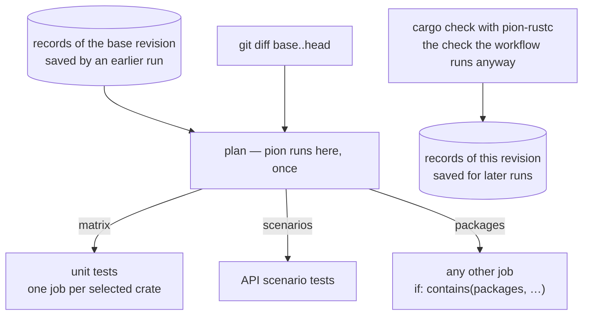

# Using pion in CI

Run pion once, at the start of the workflow. Every other job reads what it
needs from that one plan.



## Why once

- The plan is one decision. If each job planned for itself, two jobs could
  disagree, and a failure would have to be traced through several plans.
- Planning is cheap but not free: it reads the records of the whole
  workspace. Doing that in a hundred jobs wastes the time it was meant to
  save.
- A job that only reads `needs.plan.outputs` needs neither pion nor the
  records, so most jobs stay exactly as they are.

## The records come from the base, not from this run

pion needs to know which definition refers to which. If it had to wait for
this revision to compile, it could not run first. So the plan uses the
records of the base revision: the ones an earlier run saved after its own
check. `--refs-revision base` tells pion that a changed line should be looked
up in the code as it was before the change.

Code that is new in the change is reached through the existing lines that
had to change to call it. A new item added between existing items falls back
to the whole crate.

The check with `pion-rustc` still runs, in its own job, and saves the records
of this revision for the runs that come after. It is not on the path to the
plan.

## Layout

```yaml
jobs:
  plan:
    runs-on: ubuntu-latest
    outputs:
      any: ${{ steps.plan.outputs.any }}
      packages: ${{ steps.plan.outputs.packages }}
      filtersets: ${{ steps.plan.outputs.filtersets }}
      matrix: ${{ steps.plan.outputs.matrix }}
      scenarios: ${{ steps.plan.outputs.scenarios }}
    steps:
      - uses: actions/checkout@v4
        with:
          fetch-depth: 0
      - uses: quantum-box/pion@59162972b0baf26cc62d28154c5e6637715b673d # v0.1.2
        with:
          version: v0.1.2
      # Restore the records the base revision's run saved, into ./pion-refs.
      # How they are stored (an artifact, a cache, a bucket) is up to the
      # workflow; pion only reads the directory.
      - name: Restore the base revision's records
        run: ./ci/restore-pion-refs.sh "$BASE_SHA" pion-refs
      - id: plan
        run: |
          cargo pion plan --base "$BASE_SHA" \
            --refs pion-refs --refs-revision base \
            --scenarios apps/api/tests/scenarios \
            --format github-output >> "$GITHUB_OUTPUT"

  # One job per selected crate, each running only the tests the plan chose.
  unit-tests:
    needs: plan
    if: needs.plan.outputs.any == 'true'
    strategy:
      fail-fast: false
      matrix: ${{ fromJSON(needs.plan.outputs.matrix) }}
    runs-on: ubuntu-latest
    steps:
      - uses: actions/checkout@v4
      - run: cargo nextest run --package "$PACKAGE" -E "$FILTERSET"
        env:
          PACKAGE: ${{ matrix.package }}
          FILTERSET: ${{ matrix.filterset }}

  # An existing job for one crate keeps its shape and gains a condition.
  test-auth:
    needs: plan
    if: contains(fromJSON(needs.plan.outputs.packages), 'auth')
    runs-on: ubuntu-latest
    steps:
      - uses: actions/checkout@v4
      - run: cargo nextest run --package auth -E "$FILTERSET"
        env:
          FILTERSET: ${{ fromJSON(needs.plan.outputs.filtersets).auth }}

  # The check the workflow runs anyway. It also writes this revision's
  # records, for later runs to plan against.
  check:
    runs-on: ubuntu-latest
    steps:
      - uses: actions/checkout@v4
      - uses: quantum-box/pion@59162972b0baf26cc62d28154c5e6637715b673d # v0.1.2
        id: pion
        with:
          version: v0.1.2
          rustc-nightly: nightly-2026-06-04
      - run: cargo check --workspace --all-targets
        env:
          RUSTC_WORKSPACE_WRAPPER: ${{ steps.pion.outputs.pion-rustc }}
          PION_REFS_DIR: ${{ github.workspace }}/pion-refs
      - name: Save this revision's records
        run: ./ci/save-pion-refs.sh "$GITHUB_SHA" pion-refs
```

## What `--format github-output` writes

One `key=value` line per output, each value on one line:

| Output | Value |
| --- | --- |
| `any` | `true` when a test or scenario is selected |
| `packages` | The selected crates, as a JSON array |
| `filtersets` | Crate → the nextest filterset for that crate, as a JSON object |
| `filterset` | One filterset for everything; empty when no test is selected |
| `features` | The features the selected crates need, as a JSON array of `<crate>/<feature>`; pass them to `--features` |
| `matrix` | `{"include":[{"package":…,"filterset":…,"features":[…]}]}` for `strategy.matrix` |
| `scenarios` | The selected scenario files, as a JSON array |
| `uncovered` | Changed files no rule covers, as a JSON array |

A matrix with no entries is an error in GitHub Actions, so guard the matrix
job with `any`.

## When there are no records for the base

The first run, or a base whose run did not finish, has no records. Run the
plan without `--refs`: pion then selects whole crates from the dependency
graph, which is correct and wider.

## Keep running everything somewhere

Selection from references can miss what they do not show. Run every test on
a schedule and compare, with `cargo pion audit`, the failures against the
plan for the same change. See [Checking the selection](../README.md#checking-the-selection).
